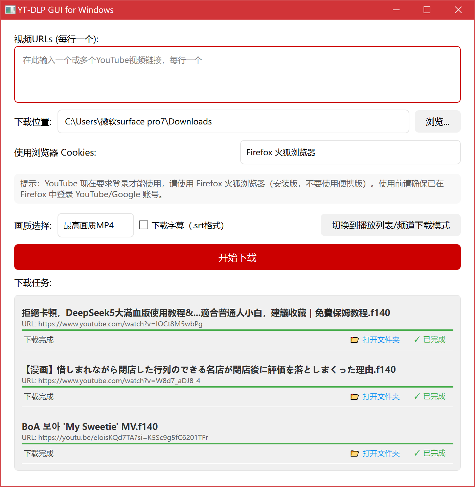
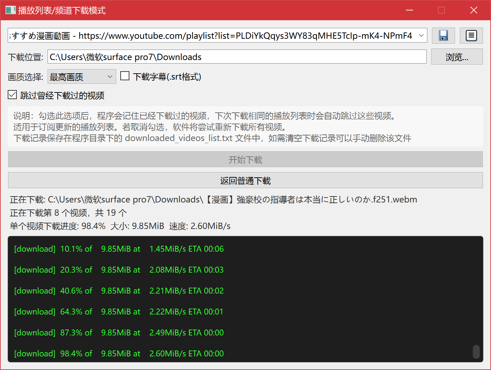

# YT-DLP GUI for Windows

> **4K 下载报 403？先检查 Firefox 更新。** 如果同一视频在 Firefox 里标清能播、4K 却一直转圈，先更新并重启 Firefox，确认网页能播放 4K 后，再回软件重试。

这是一个基于 yt-dlp 的 Windows 视频下载软件，支持单个或多个视频、YouTube 播放列表与频道下载，也支持选择画质、提取 MP3 和下载字幕。

## 下载与使用

1. 从 [Releases](https://github.com/luluyayawawa123/yt-dlp-gui-windows/releases) 下载绿色版，解压后运行 `YT-DLP-GUI-Windows.exe`。绿色版文件夹可以移动或改名，但请保留其中的 `bin` 目录。
2. 普通下载：先在 Firefox 中登录 YouTube 并保持登录，再把视频链接粘贴到主窗口。多个链接每行填一个；选好保存位置、画质和字幕后，点击“开始下载”。
3. 播放列表/频道下载：切换到对应窗口，输入播放列表或频道链接。可勾选“跳过曾经下载过的视频”，下次只下载新增内容。

普通下载可选择最高画质、MP4 画质、MP3，或临时兜底的“斗地主模式”。实际能下载的清晰度取决于视频、网络和 YouTube 返回的格式，并非每个视频都有 4K。

普通下载与播放列表共用字幕开关、字幕语言和六种通用画质设置，任一窗口修改后会立即同步并在重启后保留。“斗地主模式”仅属于普通下载，不会覆盖播放列表最近使用的通用画质。

## 当前 YouTube 下载方式

v1.1.9 使用 yt-dlp 维护者提供的 SABR 实验内核，尚未合并到上游正式版。原有操作不变，内核根据可用格式和画质要求自动选择传统 HTTPS 或 SABR；不是所有下载都会走 SABR。普通模式已完成 HTTPS 4K 实测，强制 SABR 480P 下载、音视频合并和真实中断续传也已验证。新版内核的播放列表整批 GUI 下载和重新打包绿色版尚需实测，不代表所有账号故障均已解决。

| 模式 | 客户端 | Firefox Cookies | 说明 |
| --- | --- | --- | --- |
| 普通下载 | mweb | 使用 | 通过内置 bgutil 组件获取 PO Token，可下载分离的视频和音频。 |
| 播放列表/频道 | mweb | 使用 | 与普通下载使用同一套 Cookies 和 PO Token 链路，逐条下载并自动恢复可重试故障。 |
| 斗地主模式（普通下载中的临时兜底） | web_safari | 使用 | 不获取 PO Token，尝试下载最高 1080P 的 HLS 流；部分视频可能没有可用流。 |

普通下载已完成开发版 4K 和绿色版的实际下载测试。播放列表现已改为读取 Firefox Cookies；每个视频遇到媒体 403、DNS 解析失败、PO Token 启动超时或生成失败时，会重新解析下载地址并断点续传，首次加自动恢复最多尝试 6 次。单个视频最终失败后会记录原因并继续下一个；登录验证或 Cookies 不可用会停止整个列表，避免连续无效请求。播放列表的视频、字幕和自动恢复流程已经通过开发版实际测试，绿色版验证见 [软件开发待办事项](软件开发待办事项.txt)。

普通下载和播放列表的字幕浮动菜单可选择简体中文、繁体中文、英语、日语和韩语，默认只选英语。每类只下载一个版本：繁体中文优先台湾，英语优先美国，日语和韩语优先对应本地区版本；没有首选版本时自动降级到同语言的其他版本。勾选“全部其他可用字幕”后，五种语言选项会停用，并改为下载全部可用字幕。普通模式和播放列表默认只选作者字幕并转换为 SRT，“斗地主模式”还会尝试自动字幕。

播放列表的字幕菜单另有“仅下载字幕，不下载视频”，该选项只属于播放列表，不影响普通下载模式。仅字幕模式会忽略下载档案，保留已有同名字幕，并在可恢复故障下最多尝试 6 次；从第 2 次开始，每次都会刷新当前视频的 PO Token。播放列表结束时会分别统计视频和字幕的成功、失败数量；存在未匹配到字幕的视频时会另行列出。该模式已通过 13 个简体中文 SRT 的实际下载测试。

## 运行环境与更新

- 支持 Windows 10/11。普通下载、播放列表和“斗地主模式”均需要 Firefox，且应先在浏览器中登录 YouTube。
- 绿色版已包含 yt-dlp、FFmpeg、Deno 和 PO Token 组件，使用者不需要另行安装这些运行组件。
- 使用 `bin/更新SABR内核.bat` 更新 SABR 实验内核。`bin/更新Nightly内核.bat` 用于切换到 Nightly；当前上游尚未合并 SABR，切回后会失去此实验支持。这些脚本**只更新 yt-dlp 内核**，不会更新 bgutil 插件、脚本或 Deno。
- PO Token 组件的配套更新方法见 [维护说明](bin/bgutil-ytdlp-pot-provider%20维护说明.txt)。

## 下载失败时

- Firefox 标清能播、4K 却一直转圈：先更新并重启 Firefox。2026-11-11 的一次实测中，更新后未更换出口 IP，网页 4K 播放和软件 4K 下载均恢复；具体根因未确定，此方法不保证解决所有 403。
- 提示 `LOGIN_REQUIRED` / `Sign in to confirm you’re not a bot`：YouTube 要求登录验证，并非 PO Token 生成失败。请先检查 Firefox 是否仍处于登录状态，必要时更换出口网络后重试。
- 已取得格式或 Token，却在下载媒体时收到 `HTTP 403`：先试软件的“下载重试”；若仍失败，请查看完整日志。更新 yt-dlp 或 PO Token 组件也不能保证消除所有 403。
- 提示 DNS 解析失败：检查网络、VPN、代理和 DNS 设置。这与 Token 生成失败是两回事。
- 需要临时获取视频时，可试普通下载中的“斗地主模式”；若视频没有可用 HLS 流，该模式也可能失败。

当前技术链、历史问题和后续研究入口见 [YouTube 下载技术与问题研究记录](YouTube下载技术与问题研究记录.txt)。
